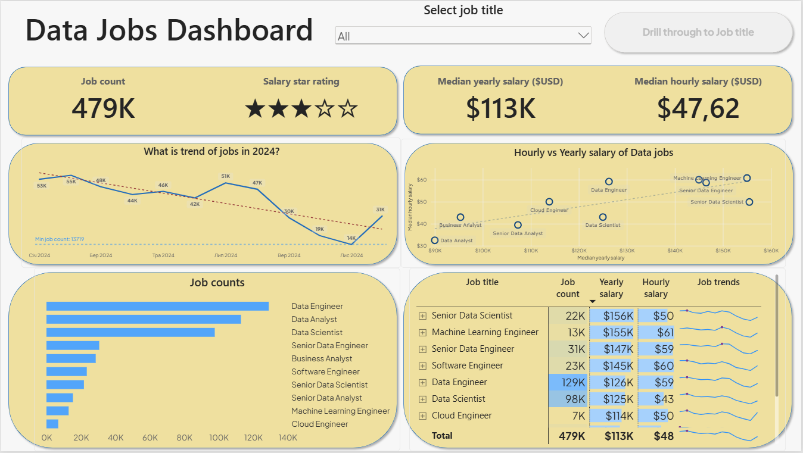
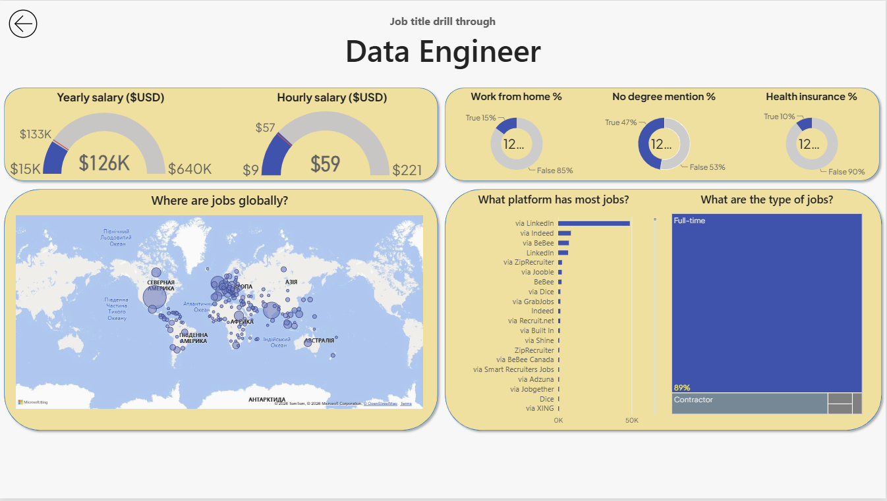

# Data Jobs Dashboard w/ Power BI

[View interactive dashboard here]()
## Introduction

This **dashboard** was created *not today*

## Skills showcased

- **Data transformation with (ETL) with Power Query**
- **Implicit measures**
- **Core charts:** *Column, Bar, Line and Area charts*
- **Geospatial analysis:** *Map charts*
- **KPI indicators & tables:** *Cards and tables*
- **Dashboard design**
- **Interactive reporting:**
    - *Slicers*
    - *Buttons and bookmarks*
    - *Drill-through*

    ## Dashboard overview

    ### Page 1: High-level market view

    

    ### Page 2: Job title drill through

    

    ## Conclusion 
    
    None